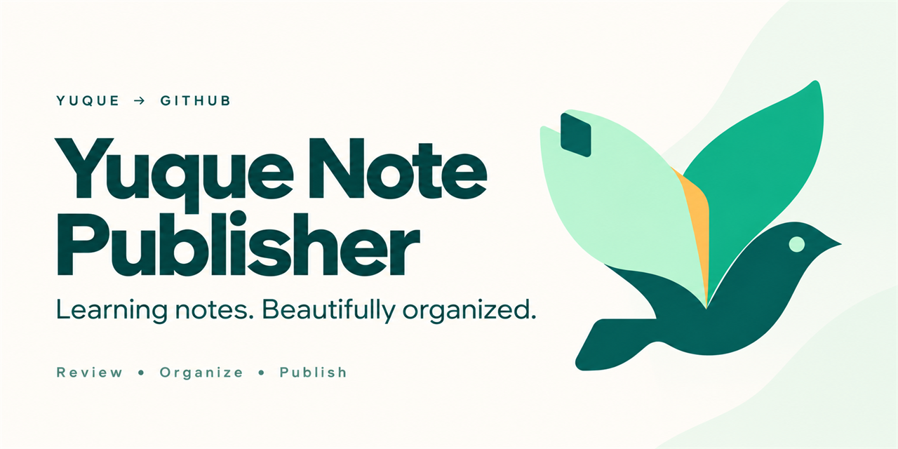

<p align="center">
  
</p>

<p align="center">
  <strong>Turn Yuque learning notes into a lasting GitHub knowledge repository.</strong>
</p>

<p align="center">
  <a href="https://github.com/pinkman1893/yuque-note-publisher/actions/workflows/ci.yml"></a>
  <a href="https://github.com/pinkman1893/yuque-note-publisher/releases/tag/v0.1.0"></a>
  <a href="pyproject.toml"></a>
  <a href="LICENSE"></a>
</p>

<p align="center">
  <a href="#install">Quick start</a> ·
  <a href="#use">Usage</a> ·
  <a href="docs/cli.md">CLI reference</a> ·
  <a href="docs/architecture.md">Architecture</a> ·
  <a href="README.md">中文</a>
</p>

---

A review-first Agent Skill and dependency-free Python toolkit for turning selected Yuque learning notes into a maintainable GitHub knowledge repository.

The agent reviews content, chooses meaningful folders, asks before substantive edits, and handles Git publication. The Python tools fetch Markdown, localize images, track a conservative API budget, persist three-note rounds, and maintain history and navigation. **The CLI does not call a model or push to GitHub on its own.**

## Install

Python 3.10+ is required. This project is not published to PyPI.

```sh
git clone https://github.com/pinkman1893/yuque-note-publisher.git
cd yuque-note-publisher
python -m pip install -e .
yuque-note --help
```

Copy `skills/yuque-note-publisher/` into your agent's skills directory. Back up an existing skill of the same name before replacing it. The self-contained scripts also run directly without package installation.

## Use

Set `YUQUE_PERSONAL_TOKEN` in your environment. `.env` files are not loaded automatically. Choose your destination repository explicitly; no personal repository is hard-coded.

```sh
yuque-note usage
yuque-note fetch --url https://www.yuque.com/OWNER/BOOK/DOC \
  --output ../private-staging/note.md --assets-dir ../private-staging/assets
```

Keep staging outside your public notes repository. Failed media downloads can resume from private local caches without fetching the source document again. Fetch emits Markdown, assets, and a `.meta.json` sidecar.

## Principles

- Fetch exact links directly. Never enumerate all account knowledge bases.
- Keep creation dates stable in filenames, using Asia/Shanghai dates.
- Review notes as personal learning records, not publication-grade textbooks.
- Record knowledge evolution, not formatting fixes or assistant conversations.
- Keep API requests serial. The default local budget is 45; zero blocks API requests.
- Never send the Yuque token to image hosts; block cross-boundary API redirects.
- Keep author voice in public notes and commit messages.

## Status and development

Version 0.1.0 is an Alpha. Core commands have offline tests and a Windows/Linux CI matrix. Complex Yuque embeds, reference-style image syntax, attachments, and crop metadata still need manual review. Markdown instructions and examples are primarily in Chinese because the workflow originated in a Chinese learning-note practice.

```sh
python -m unittest discover -s tests -v
```

See [architecture](docs/architecture.md), [contributing](CONTRIBUTING.md), [security](SECURITY.md), and the [agent workflow](skills/yuque-note-publisher/references/workflow.md).
