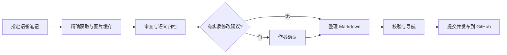

# Yuque Note Publisher

**把语雀里的学习笔记，整理成 GitHub 上可持续维护的知识库。**

[](https://github.com/pinkman1893/yuque-note-publisher/actions/workflows/ci.yml)
[](pyproject.toml)
[](LICENSE)

[快速开始](#快速开始) · [工作流程](#工作流程) · [CLI 参考](docs/cli.md) · [设计说明](docs/architecture.md) · [English](README.en.md)

在语雀里写笔记，在 GitHub 上形成长期的学习地图。这个项目提供一套可安装的 **Agent Skill** 和 **零运行时第三方依赖的 Python 工具**，覆盖精确获取、内容审查、语义归档、图片本地化、更新记录、导航与断点恢复。

来自真实的个人学习归档流程，面向愿意保留个人表达、同时让笔记适合公开阅读的人。当前版本为 **0.1.0 / Alpha**，提供可运行的核心工具、离线测试和 Windows/Linux CI；尚未覆盖所有语雀富文本和媒体类型。

## 为什么做这个

直接导出 Markdown 通常只完成了第一步。图片可能仍依赖外链，目录需要整理，更新后的旧笔记需要找到原位置，文件日期也容易被误写成上传日期。

Yuque Note Publisher 把这些重复工作交给脚本，把内容判断留给 Agent 和作者：

- **指定哪篇，处理哪篇**：精确链接直接抓正文，避免为了找一篇笔记扫描所有知识库。
- **归档有语境**：结合正文和现有目录判断领域/主题，区分课程笔记、刷题总结与项目实践。
- **保留笔记的时间线**：文件日期固定取创建日期，只记录实质知识补充，不把修复过程写成学习成果。
- **媒体与笔记一起维护**：图片按内容哈希保存，Markdown 与 HTML 图片使用本地相对路径。
- **额度看得见**：API 串行请求、本地预算、保守计数、短 429 等待、图片断点续传。
- **作者保持控制**：实质改写先确认，公开正文和提交说明不使用助手工作口吻。

## 工作流程



**脚本不自带模型，也不会自动 git push。** Agent 读取 skill 后组织端到端流程；CLI 可以独立使用。它不是语雀全量备份器，也没有后台定时扫描。

输出结构示例：

```text
my-notes/
├── README.md
├── 编程语言/
│   └── Python/
│       ├── README.md
│       ├── 2026-01-02-生成器与迭代器.md
│       └── assets/12345/9d8b7c6e5f40.png
└── 数据结构与算法/
    ├── 课程笔记/
    └── 刷题记录/
```

## 快速开始

需要 Python 3.10+。Git/GitHub CLI 只在 Agent 发布阶段需要。工具尚未发布到 PyPI，使用仓库安装：

```sh
git clone https://github.com/pinkman1893/yuque-note-publisher.git
cd yuque-note-publisher
python -m pip install -e .
yuque-note --help
```

### 1. 配置凭据

macOS / Linux：

```sh
export YUQUE_PERSONAL_TOKEN='YOUR_TOKEN'
export YUQUE_API_DAILY_BUDGET=45
```

Windows PowerShell：

```powershell
$env:YUQUE_PERSONAL_TOKEN = 'YOUR_TOKEN'
$env:YUQUE_API_DAILY_BUDGET = '45'
```

`.env.example` 只作说明，程序不会自动加载 `.env`。Token、私有 state 和正文缓存不应提交到仓库。预算是本地保护值，**不是语雀官方配额**；`0` 表示禁止 API 调用。

### 2. 安装 skill

把 `skills/yuque-note-publisher/` 整个目录复制到 Agent 使用的 skills 目录。已有同名个人 skill 时，先备份并检查差异，不要直接覆盖。

例如，在没有同名 skill 的 Codex 安装中，可复制到 `~/.codex/skills/yuque-note-publisher/`。skill 自带脚本，直接以 `python scripts/yuque_note.py` 运行时不需要先安装 Python 包。其他 Agent 使用其对应的 skill 安装目录。

告诉 Agent 目的笔记仓库与本地路径，再发出请求：

> 把这篇语雀笔记检查并归档到我的笔记仓库。文件日期用创建日期，实质修改先列出来确认。

项目私有配置示例见 [examples/publisher.example.json](examples/publisher.example.json)。这些信息由 Agent 读取，不是一个会自动执行发布的配置程序。

### 3. 单独使用 CLI

```sh
# 读取本地计数，不请求语雀
yuque-note usage

# 用真实文档链接替换示例；staging 必须位于目的笔记仓库之外
yuque-note fetch \
  --url https://www.yuque.com/OWNER/BOOK/DOC \
  --output ../private-staging/note.md \
  --assets-dir ../private-staging/assets
```

得到 Markdown、本地图片及 `note.meta.json`。首次整理后使用固定创建日期命名；再次更新时沿用原归档位置。

## 工具边界

| 工具 | 负责什么 |
| --- | --- |
| `yuque-note` | 正文/目录获取、媒体本地化、保守 API 计数 |
| `yuque-checkpoint` | 三篇分轮、待确认/待推送状态、跨会话恢复 |
| `yuque-history` | 幂等维护知识内容更新表，拒绝常见助手口吻 |
| `yuque-homepage` | 按领域和主题生成展开式完整导航 |
| Agent Skill | 审查、归档决策、确认、验证与 Git 发布 |

详细行为、命令顺序和失败恢复见 [CLI 参考](docs/cli.md) 与 [工作流](skills/yuque-note-publisher/references/workflow.md)。

## 开发与质量

```sh
python -m pip install -e .
python -m unittest discover -s tests -v
```

测试使用虚构笔记和模拟 HTTP，不访问个人语雀文档，也不消耗 API。CI 在 Windows/Linux、Python 3.10/3.12/3.13 上运行同一组测试。没有经过测试的能力不会标为已支持：复杂画板、引用式图片、附件和裁切渲染需人工核对。

## 文档与参与

- [架构与取舍](docs/architecture.md)：Agent 与脚本分工、单一代码来源、状态与配额。
- [CLI 参考](docs/cli.md)：命令、配置和恢复方法。
- [完整离线示例](examples/README.md)：不用 Token 即可试验更新记录与导航。
- [贡献指南](CONTRIBUTING.md) · [安全说明](SECURITY.md) · [版本记录](CHANGELOG.md)

项目组织参考 [Anthropic Skills](https://github.com/anthropics/skills) 的自包含 skill 布局，以及 [uv](https://github.com/astral-sh/uv) 的快速上手与贡献文档层次。代码由既有语雀发布工具演进，不依赖上述项目代码。

## 许可

[MIT](LICENSE)。语雀笔记、图片和附件的版权属于各自权利人，工具许可不授予重新发布这些内容的权利。
